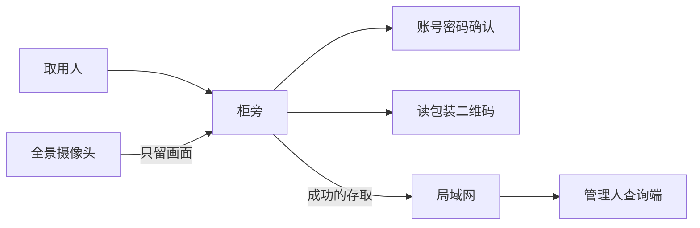

# 选题说明：实验室危化品试剂柜

> 第 3 周课程提交底稿。用语见 [CONTEXT.md](CONTEXT.md)，需求见 [需求分析.md](需求分析.md)。

## 1. 名称与一句话

- **名称**：实验室危化品试剂柜
- **一句话**：给学院实验室管化学品的人一份清单，记下每一瓶试剂的等级、在哪一格、最近谁取出或放回；等级为高的，要两名取用人先后确认才能动。

## 2. 痛点与演示场景

学院实验室里，试剂在柜中，人会忘记放在哪一格、有没有被拿走。柜子上的全景摄像头只能看到柜前有人，分不清是谁、动的是哪一瓶。管理人要一份试剂清单，现在交不出来。

演示不用真的危化品。瓶子里装普通液体，柜子用纸箱或实验室里的轻便柜搭成两格。标签写低、中、高：低和中在第一格，高在第二格。取用人确认身份并读包装上的二维码，管理人在另一台电脑上看到清单变化。

和已经在卖的成品柜相比，本题目做三件事。瓶上的名称、等级和二维码是同一张标签，清单里的等级就是瓶子上印的等级。低和中确认一次，高确认两次，确认次数跟着这一瓶的等级走。一次存取同时写下谁、哪一瓶、哪一格。少扫一次，清单不会变。不做关门自动盘整柜，不比过滤风量、称重精度和物理双锁。

## 3. 赛项与网络挂钩

- **赛项**：A 普通创意（不报 A-ST / A-ICV / B-EP1）
- **网络挂靠**：物联网
- **网络在系统里做什么**：身份确认和二维码读取在柜旁完成。只有成功的存取经局域网送到管理人的查询端。管理人在另一台电脑上打开清单，不站在柜子跟前查。全景画面留在柜旁，不拿去认人，也不拿去认瓶子。

## 4. 系统架构

柜旁判断这次确认是否够数、二维码是否和标签一致。不够数或对不上，不发出存取，清单不变。查询端只显示已经成功的记录。

## 5. 必须做 / 明确不做 / 有余力

**必须做**

- 两格模拟柜；标签含名称、等级、二维码；低和中在第一格，高在第二格
- 低和中：一名取用人账号密码确认后，读二维码，清单改变
- 高：两名取用人先后确认后，存取才成立；只有一次确认，清单不变
- 二维码和标签不一致，这次存取不成立，试剂仍算在原格
- 清单列：名称、等级、格、状态（在柜或已取出）、经手人、时间；高这一档写下两名经手人
- 管理人在另一台电脑上查看同一份清单
- 全景摄像头只留柜前画面

**明确不做（本学期）**

小车、机械臂、仓储场地、RFID 群读、称重余量、通风过滤、VOC、冷藏、短信或手机应用、向公安机关自动报案、真危化品、把全景摄像头当作认人或认瓶的手段。法定「五双」只在说明里引用。高这一档用两次登录，不装两把机械锁，不称为已经满足「五双」。标签上的「高」不等于法规里的剧毒。

**有余力**

人脸作为密码之外的另一种确认。查询端把新存取标出来。断网期间先记在柜旁、恢复后再送到查询端。

## 6. 技术选型

| 层次 | 选型 |
| --- | --- |
| 认瓶 | 包装上的统一标签和二维码，柜旁摄像头或扫码模块读取 |
| 认人 | 账号密码。高这一档连续两次登录 |
| 柜旁 | 队里已有的树莓派：完成本地确认、读码，并只把成功存取送出 |
| 查询端 | 演示笔记本上的网页，打开清单 |
| 全景 | 已有海康一类摄像头，只留画面 |
| 协作 | Git 分支 + PR 合入 main（见 README） |

## 7. 分工

队内情况：武汉轻工大学本科，5 人，大二和大三；指导教师高路。无外部经费。设备为已有的树莓派、摄像头和海康。本学期交课程作品，明年参加正式比赛。

指导教师要求大二的两人从设计看这个题目，另外两人从实现看，并且都要参加。第五人做联调与文档。

| 岗位 | 人数 | 职责 |
| --- | --- | --- |
| 设计 | 2 | 标签与等级、两格规则、清单字段、演示路径。从设计看 |
| 柜旁 | 1 | 读码、账号确认、成功存取才送出 |
| 查询端 | 1 | 清单网页，另一台电脑上查看 |
| 联调与文档 | 1 | 模拟柜、联调、第 5/7/9 周进度材料与解说视频 |

## 8. 风险

- **扫码才能入账**：瓶子没放到可读位置，清单不会变。演示要规定拿出、扫码、放回的顺序。
- **两次确认容易做虚**：高这一档必须能当场看出少一次确认就拒绝，不能只口头说有双人。
- **全景摄像头**：若拿去认人或认瓶，题目会做成监控。画面只留在柜旁。
- **模拟柜**：两格轻便柜说明的是记录方式。不和带过滤、称重的成品钢柜比柜体。

## 9. 12 周对齐（备忘）

- 第 3 周：本题选说明
- 第 5 周：两格模拟柜就位；读出标签上的名称和等级；账号密码能完成一次确认
- 第 7 周：低、中存取写入清单；管理人在另一台电脑上打开清单
- 第 9 周：高这一档两次确认，少一次不入账；二维码与标签不一致不入账；解说视频脚本
- 第 12 周：约 3 分钟固定演示路径；考前文档与视频

指导教师希望十一月底能看到第 9 周这一条闭环。

## 10. 细则来源

行为与用语以 [CONTEXT.md](CONTEXT.md) 为准。谁在用、必须演示什么、明确不做什么，以 [需求分析.md](需求分析.md) 为准。成品柜页面与已打开的法规见 [docs/research/实验室智能试剂柜现有产品.md](docs/research/实验室智能试剂柜现有产品.md)。
